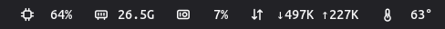
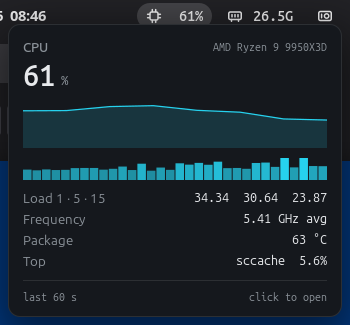
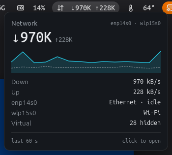
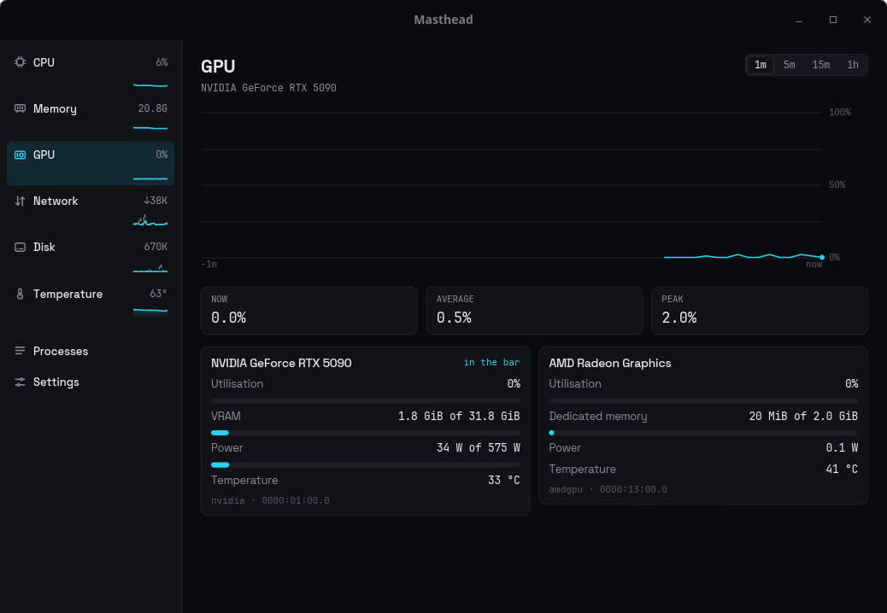
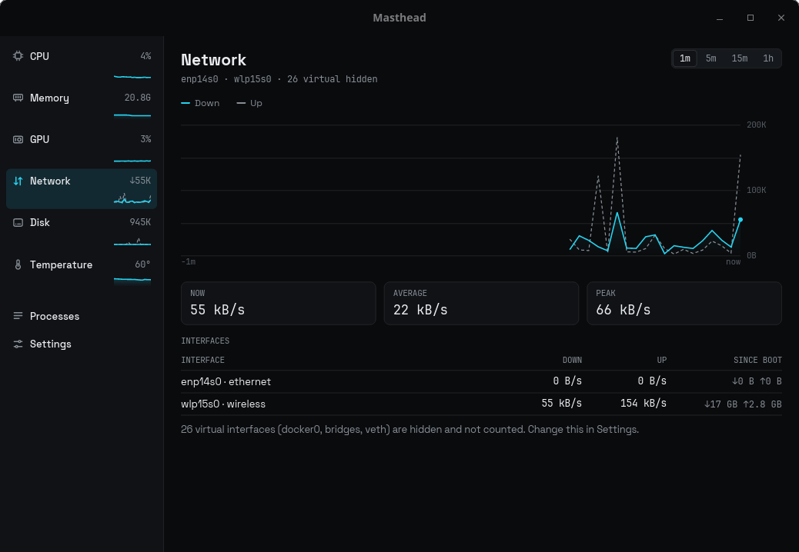

<!--
  Copyright 2026 Kitefold Labs
  SPDX-License-Identifier: Apache-2.0
-->

# Masthead

A Linux system monitor for the top bar. CPU, memory, GPU, network, disk,
temperature and battery as numbers at a glance, detail on hover, graphs on
click, at a resting cost of 0.06% of one CPU core and no disk writes.



<p>
  
  
</p>

<p>
  
  
</p>

One small daemon samples `/proc` and `/sys` and publishes on D-Bus. Each
desktop gets a thin native face that only draws:

| Desktop | Face |
|---|---|
| GNOME Shell 45–50 | Extension: bar items, hover popovers, click for the window |
| COSMIC | Panel applet |
| Waybar, Ironbar, eww, i3bar, swaybar | `masthead-bar` (JSON or i3bar protocol) |
| KDE Plasma, XFCE, Cinnamon, MATE, Budgie | Tray items, shown automatically |

The window (`masthead-window`) is read-only: charts over 1 minute to 1 hour,
per-device detail, a process table and settings.

## Install

Needs Rust (rustup installs the pinned 1.99), [just](https://github.com/casey/just),
and the libcosmic build headers. On Debian or Ubuntu:

```sh
sudo apt install pkg-config libxkbcommon-dev libwayland-dev libinput-dev \
    libudev-dev libexpat1-dev libfontconfig-dev libfreetype-dev libegl-dev
just install        # release build, installed into ~/.local
```

Then on GNOME, log out and back in and run
`gnome-extensions enable masthead@kitefoldlabs.com`. For COSMIC, Waybar and
i3 setup, see [docs/install.md](docs/install.md). `just deb` builds a Debian
package that installs under `/usr`.

## Run

Nothing to start by hand. The first face that connects starts the daemon
through D-Bus activation, and systemd keeps it running. Click a bar item to
open the window, or run it directly:

```sh
masthead-window --metric gpu      # cpu, mem, gpu, net, disk, temp, battery, processes, settings
masthead-bar --format plain       # live values in a terminal
masthead-daemon --print           # detected hardware and one sample, as JSON
```

Settings live in `~/.config/masthead/config.toml`; see
[docs/configuration.md](docs/configuration.md).

## Uninstall

```sh
gnome-extensions disable masthead@kitefoldlabs.com   # GNOME only
just uninstall      # stops the daemon and removes everything from ~/.local
```

## Efficiency

Measured on a Ryzen 9 9950X3D with an RTX 5090, release builds:

| | CPU, one core | Memory | Disk writes |
|---|---|---|---|
| Daemon, bar only | 0.06% | 4.9 MB | 0 |
| Daemon, NVIDIA GPU in the bar | 0.06% | 25 MB | 0 |
| Detail window, open | 0.3–1.9% | 33 MB, freed on close | 0 |
| COSMIC applet | 0.12% | 25 MB | 0 |

- One wakeup per second, with 50 ms timer slack. Nothing is sampled while no
  face is subscribed or the screen is locked.
- About 100 µs of reading per sample: files stay open and are re-read with
  `pread`, and parsed in place. A test fails the build on any heap
  allocation in steady-state sampling.
- NVIDIA's NVML library is loaded only while GPU data is on screen and
  unloaded a minute later; it is the 20 MB difference above.
- CI runs the daemon for five minutes and fails if it exceeds 0.1% of a core
  or 6 MB.

The COSMIC applet is over budget; see [#1](https://github.com/kitefold-labs/masthead/issues/1).
Method and per-source timings: [docs/resource-budget.md](docs/resource-budget.md).

## More

[Architecture](docs/architecture.md) ·
[D-Bus API](docs/dbus-api.md) ·
[Development](docs/development.md) ·
[GNOME extension](shell/gnome/README.md) ·
[COSMIC applet](crates/masthead-cosmic/README.md)

Apache License 2.0. The COSMIC applet binary links GPL-3.0 COSMIC panel code;
see [its README](crates/masthead-cosmic/README.md#license).
